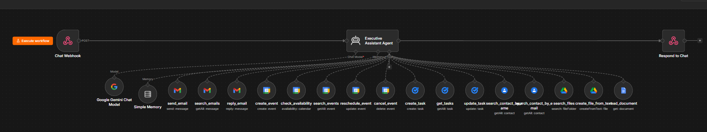

# Autonomous AI Executive Assistant (Google Workspace & Gemini)

An autonomous multi-tool AI assistant built on **n8n** and powered by the **Google Gemini API**. It receives natural language requests via **Google Chat** (via Webhook) and automatically orchestrates Google Workspace tools to execute tasks, triage emails, schedule meetings, and inspect Google Drive.

---

## System Architecture

---

## Core Capabilities

* **Google Chat Interface:** Bi-directional HTTP webhook trigger delivering parsed JSON responses.
* **Gmail Management:** Search unread messages, fetch threads, draft context-aware replies, and send new emails.
* **Calendar Operations:** Availability checks, conflict detection, event creation, rescheduling, and cancellations.
* **Tasks & Contacts:** Automated task creation with due dates and contact lookup for verified recipient details.
* **State Management:** Uses memory nodes to preserve context across multi-turn user conversations.

---

## Tech Stack

* **Workflow Orchestrator:** n8n
* **LLM Engine:** Google Gemini
* **APIs Integrated:** Gmail, Google Calendar, Google Tasks, Google Contacts, Google Drive, Google Chat
* **Protocol:** REST Webhooks / JSON Payload Actions

---

## How to Import & Run

1. Clone or download `google-workspace-executive-agent.json`.
2. In n8n, navigate to **Workflows** > **Import from File**.
3. Connect your respective credentials:
   * **Google Gemini API Key**
   * **Google Workspace OAuth2 Credentials**
4. Copy your production webhook URL into your **Google Cloud Console > Google Chat API** configuration.
5. Toggle the workflow to **Published**.
